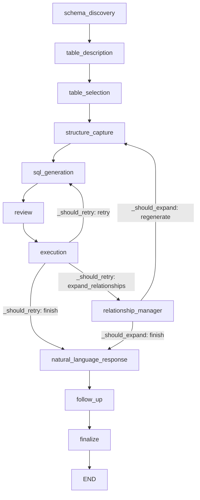

# SQL Agent — Query Execution Flow (Node by Node)

This document traces exactly what happens to a user query as it moves through the
`sql_agent` LangGraph workflow, node by node, including the state that is read and
written at each step, the routing decisions between nodes, and the exact code
locations where the known correctness/security issues live.

Use this as the reference map before implementing the hardening fixes.

---

## 1. Entry Point

**File:** [`sql_agent/orchestrator.py`](../sql_agent/orchestrator.py) → `SQLAgentOrchestrator.process_query`

```
process_query(user_query, partner_id)
```

1. Validates `partner_id` is present (`ValueError` if missing).
2. Builds the `initial_state` dict (all `AgentState` keys initialized).
3. Invokes the compiled graph: `await self.graph.ainvoke(initial_state, config={"recursion_limit": 50})`.
4. Parses `final_state["final_response"]` (a JSON string) and returns it.

### State shape (`AgentState`)

Defined in [`sql_agent/state.py`](../sql_agent/state.py):

| Key | Type | Purpose |
|-----|------|---------|
| `messages` | `Annotated[Sequence, operator.add]` | Append-only log (reducer merges) |
| `user_query` | `str` | Raw NL question |
| `db_config` | `dict` | Connection/description context |
| `schema_metadata` | `dict` | `{tables, relationships, table_descriptions, cached}` |
| `selected_tables` | `list` | Tables chosen for this query |
| `table_structures` | `dict` | Column/FK details for selected tables |
| `generated_sql` | `str` | Current SQL candidate |
| `validation_result` | `dict` | Review agent output |
| `execution_result` | `dict` | `{success, rows, row_count, columns, error}` |
| `retry_count` | `int` | Retry / expansion counter |
| `related_tables` | `list` | FK-expanded tables |
| `final_response` | `str` | JSON string returned to caller |
| `error` | `str` | Last error message |
| `partner_id` | `int` | **Tenant isolation key** |
| `natural_language_answer` | `str` | Human-readable summary |

> **Reducer caveat:** because `messages` uses `operator.add`, any node that both
> mutates `state["messages"].append(...)` **and** returns the full `state` can cause
> duplicate appends. Nodes should return partial updates instead.

---

## 2. Graph Topology

Built in `_build_graph` ([`orchestrator.py`](../sql_agent/orchestrator.py)).



- **Entry point:** `schema_discovery`
- **Terminal:** `finalize → END`
- **Two conditional routers:** `_should_retry` (after `execution`) and
  `_should_expand` (after `relationship_manager`).

---

## 3. Stage-by-Stage Walkthrough

### Stage 1 — `schema_discovery_agent`
**Reads:** cached schema/relationships · **Writes:** `schema_metadata`, `messages`

Three-tier load: (1) in-memory `orchestrator.cached_schema`, (2) disk cache via
`load_metadata`, (3) live `discover_schema_from_db(pool, ...)`. On success sets
`schema_metadata = {tables, relationships, cached}`. On failure sets `state["error"]`.

- Normal request path uses the in-memory cache — no DB hit.

---

### Stage 2 — `table_description_agent`
**Reads:** `schema_metadata.tables` · **Writes:** `schema_metadata.table_descriptions`

Loads AI-generated 1–2 sentence descriptions from memory → disk → (first-run only)
generates via `orchestrator.json_llm` per table and caches to
`table_descriptions.json`. These descriptions feed table selection accuracy.

---

### Stage 3 — `table_selection_agent`
**Reads:** `user_query`, `schema_metadata.tables`, `table_descriptions`
**Writes:** `selected_tables`, `messages`

1. Builds `table: description` block for the LLM.
2. `json_llm` returns `{selected_tables, reasoning}`; results filtered to real tables.
3. **Fallback chain:**
   - LLM returned nothing → keyword match on table-name tokens.
   - Still nothing → `selected_tables = all_tables[:3]`.

> ⚠️ **Issue #6 (fallback picks wrong tenant tables):** `all_tables[:3]` is arbitrary
> and may select tables without a `partner_id` column, which — combined with Issue #4
> — can yield an unscoped query. The fallback should prefer tenant-scoped tables.

---

### Stage 4 — `structure_capture_agent`
**Reads:** `selected_tables`, `schema_metadata.tables` · **Writes:** `table_structures`

Copies full column/FK detail for only the selected tables (keeps the SQL-gen context
small). Pure dict assembly — no LLM, no DB. This node is also the **re-entry point**
after relationship expansion.

---

### Stage 5 — `sql_generation_agent`
**Reads:** `user_query`, `table_structures`, `schema_metadata.relationships`, `partner_id`, prior `error`/`generated_sql`
**Writes (partial dict):** `generated_sql`, `error`, `messages`

1. Guards that `partner_id` exists; warns if no selected table has a `partner_id` column.
2. Builds the big prompt: **tenant rules**, **available-data window**
   (`2025-01-04 → 2026-05-31`, anchor month May 2026), **date-column rules**
   (`transaction_date` only, half-open ranges), **domain synonyms**, schema context,
   relevant relationships.
3. On retry, appends the previous failed SQL + error for self-correction.
4. `sql_llm` returns SQL; code strips markdown fences and a trailing `;`, and requires
   the statement to start with `SELECT`/`WITH`.

> ⚠️ **Issue #4 (partner_id not deterministically enforced):** the `partner_id = X`
> filter is only *requested* in the prompt. Nothing here guarantees it exists in the
> output.
> ⚠️ **Issue #5 (raw model output):** the resulting string is passed downstream and
> executed verbatim — no parameterization.

---

### Stage 6 — `review_agent`
**Reads:** `generated_sql`, `table_structures`, `partner_id` · **Writes:** `generated_sql` (maybe), `validation_result`, `messages`

`json_llm` checks for: non-existent columns, syntax errors, missing JOINs, missing/wrong
`partner_id` filter, misuse of `posting_period` / `CURRENT_DATE`. If `valid == false`
and a `corrected_sql` is returned, it replaces `generated_sql`. On any exception it
"fails open" (`validation_result = {valid: true, ...}`) and proceeds with the original
SQL.

> ⚠️ This validation is **LLM-based and advisory**. It is not a substitute for a
> deterministic `partner_id` guard (Issue #4).

---

### Stage 7 — `execution_agent`
**Reads:** `generated_sql`, `partner_id` · **Writes:** `execution_result`, `error`, `messages`

1. `validate_sql_safety(sql_query)` ([`schema.py`](../sql_agent/schema.py)) — blocks DML
   keywords (`DROP/DELETE/UPDATE/...`) and requires `SELECT`/`WITH`.
2. Runs inside `pool.acquire()` → `conn.transaction()` →
   `await asyncio.wait_for(conn.fetch(sql_query), timeout=30.0)`.
3. On success builds `{success, rows, row_count, columns}` and inserts a row into
   the `"finfit-ai".query_history` table.
4. On timeout/error sets `execution_result.success = False` and `state["error"]`.

> ⚠️ **Issue #4 / #5 land here:** `conn.fetch(sql_query)` executes the raw LLM string.
> `validate_sql_safety` blocks DML but does **not** verify a `partner_id = <id>`
> predicate is present — so an unscoped `SELECT` would still run.

---

### Routing A — `_should_retry` (after `execution`)
**File:** [`orchestrator.py`](../sql_agent/orchestrator.py)

```
if error and retry_count < MAX_RETRIES(4):      -> "retry"      (sleep, count++, clear result)
elif not success and retry_count < 4:           -> "retry"      (sleep, count++)
elif success and row_count == 0 and count < 1:  -> "expand_relationships"
else:                                           -> "finish"
```

> ⚠️ **Issue #1 (blocking sleep):** uses `time.sleep(delay)` inside the async graph —
> blocks the event loop for all concurrent requests.
> ⚠️ **Issue #2 (mutation in a router):** `state["retry_count"] = ...` is done inside a
> **conditional-edge function**. LangGraph condition functions are for routing; their
> state mutations are not reliably merged back, so `retry_count` may never actually
> increment — meaning retries are bounded only by `recursion_limit=50`, not `MAX_RETRIES`.
> **Fix direction:** move the backoff (`await asyncio.sleep`) and the counter increment
> into an actual node (e.g. the top of `sql_generation_agent`), and keep the router pure.

---

### Stage 8 — `relationship_manager_agent`
**Reads:** `selected_tables`, `relationships`, `table_descriptions`, `user_query`
**Writes:** `related_tables`, `selected_tables`, `messages`

Triggered only when the first execution returned **0 rows**. Walks FK relationships to
find neighbor tables, asks the LLM which are relevant, appends up to 3 to
`selected_tables`, then routing sends control back to `structure_capture` to regenerate.

---

### Routing B — `_should_expand` (after `relationship_manager`)
```
if related_tables and retry_count < 1:  retry_count++  -> "regenerate" (-> structure_capture)
else:                                                  -> "finish"
```

> ⚠️ Same **Issue #2** pattern: counter mutation inside a router.

---

### Stage 9 — `natural_language_response_agent`
**Reads:** `execution_result`, `user_query`, `partner_id` · **Writes:** `natural_language_answer`

- Execution failed → fixed apology string.
- 0 rows → helpful "no records" message that cites the data window
  (`2025-01-04 → 2026-05-31`, latest month May 2026).
- Rows present → `sql_llm` summarizes the first 50 rows into one sentence.

---

### Stage 10 — `finalize_response`
**Reads:** `execution_result`, `natural_language_answer`, `error` · **Writes:** `final_response`

Serializes the final payload:

```json
// success
{ "status": "success", "answer": "<nl answer>" }
// error
{ "status": "error", "error": "<msg>", "answer": "Sorry, I couldn't process your request. Please try again." }
```

`process_query` then `json.loads` this and returns it. → `END`.

---

## 4. Issue → Location Map

| # | Issue | Where | Fix direction |
|---|-------|-------|---------------|
| 1 | Blocking `time.sleep()` in async graph | `_should_retry` ([`orchestrator.py`](../sql_agent/orchestrator.py)) | Use `await asyncio.sleep` inside a node |
| 2 | Counter mutation inside routers may not persist | `_should_retry`, `_should_expand` | Increment `retry_count` in a node; keep routers pure |
| 3 | Mixed state-update pattern (append + return state) | multiple agents | Return partial updates only |
| 4 | `partner_id` filter not deterministically enforced | `sql_generation_agent` / `execution_agent` | Parse SQL and reject/inject `partner_id = <id>` before `conn.fetch` |
| 5 | Raw LLM SQL executed, no validation of literal | `execution_agent` `conn.fetch(sql_query)` | Validate `partner_id` int at boundary; deterministic guard |
| 6 | Fallback `all_tables[:3]` may be unscoped | `table_selection_agent` | Prefer tenant-scoped tables in fallback |

---

## 5. Suggested Implementation Order

1. **#1 + #2** — introduce a small `retry_gate` node (or fold backoff/increment into
   `sql_generation_agent`) using `await asyncio.sleep`; make `_should_retry` /
   `_should_expand` pure functions that only read state.
2. **#4 + #5** — add a deterministic `enforce_partner_scope(sql, partner_id)` check in
   `execution_agent` (before `conn.fetch`) that rejects any query lacking
   `partner_id = <partner_id>` on a tenant-scoped table.
3. **#6** — change the selection fallback to prefer tables whose columns include
   `partner_id`.
4. **#3** — normalize agents to return partial state updates.

Each step is independently testable with a mocked LLM and a fake asyncpg pool.
